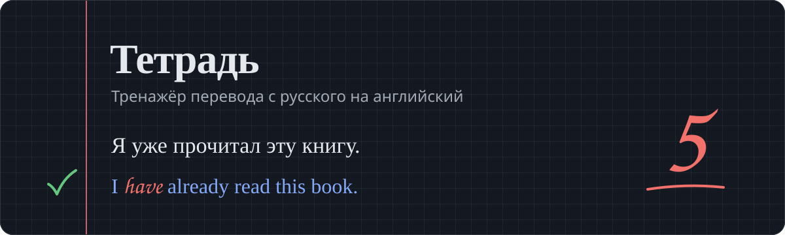
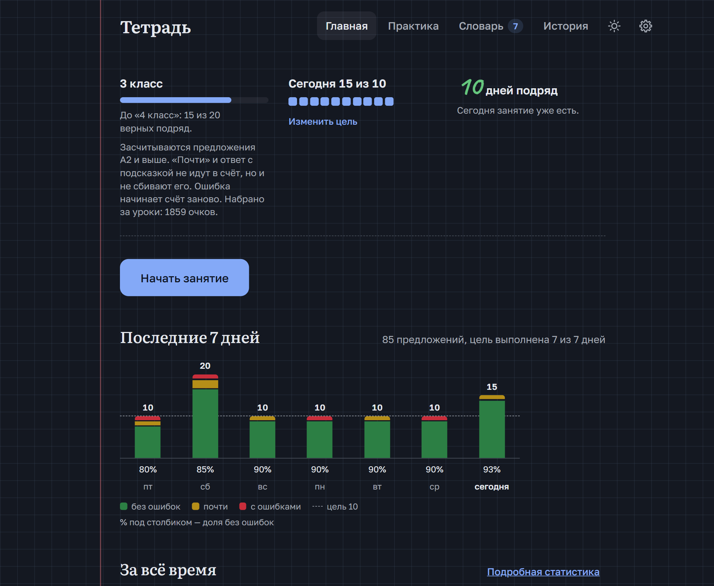
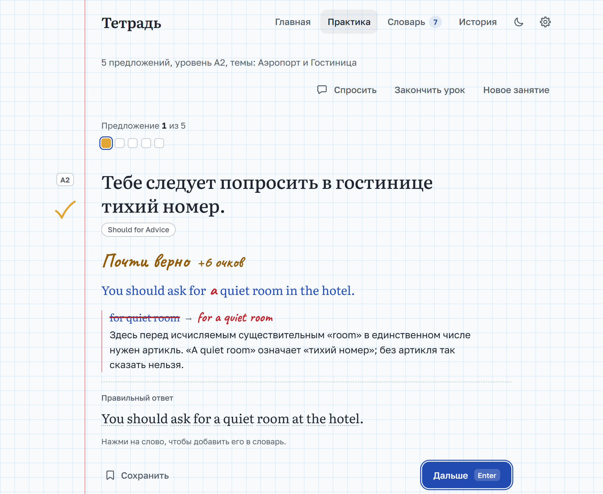
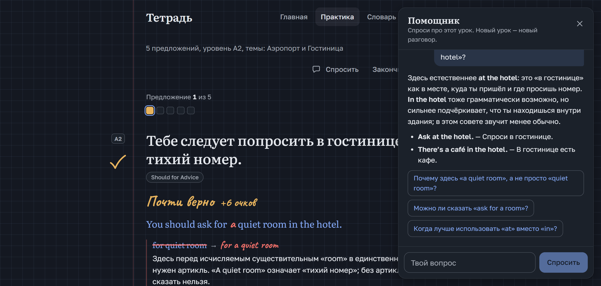
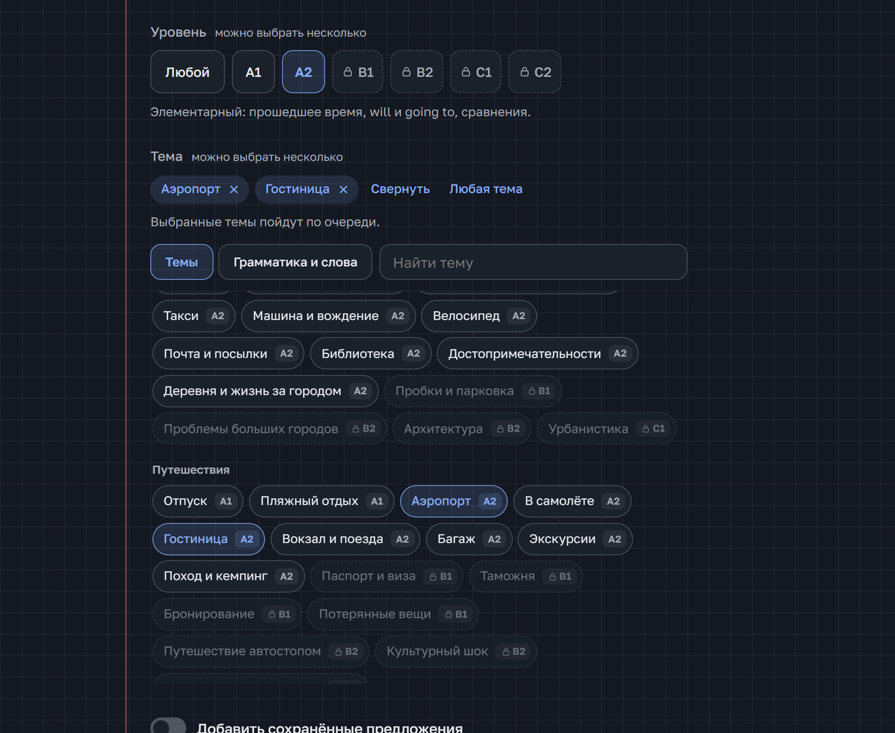
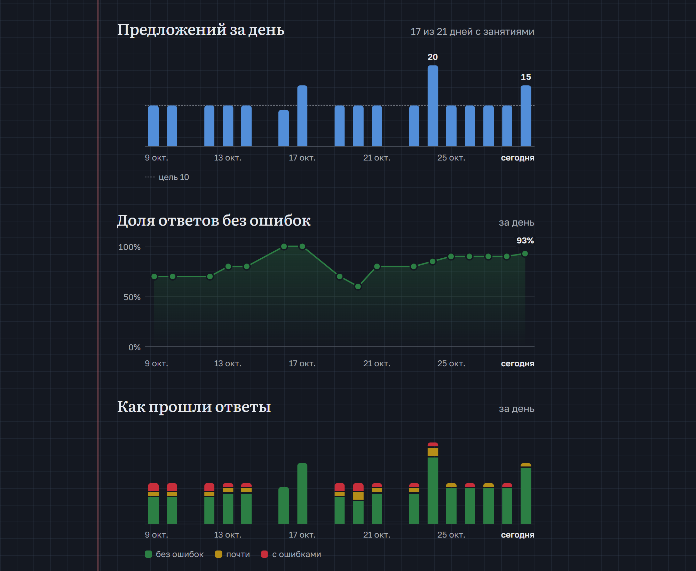
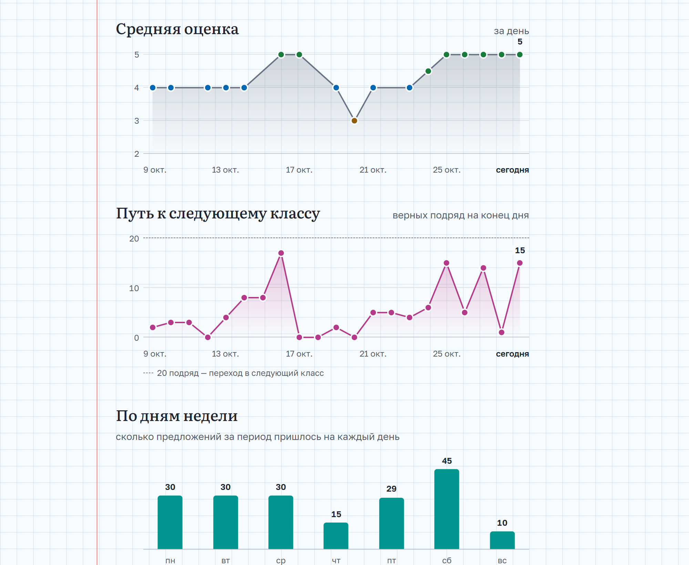
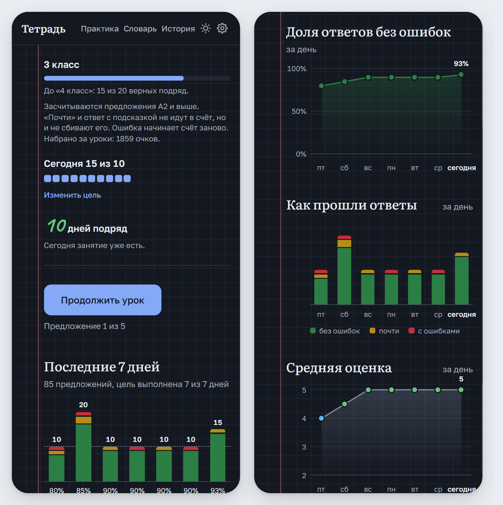

**Тетрадь** — тренажёр перевода с русского на английский. GPT пишет предложения под твой уровень и тему, проверяет перевод как учитель (с исправлениями прямо в тексте и объяснением на русском) и отвечает на вопросы по уроку. Прогресс копится как в школе: классы, оценки, серия дней, а подробная статистика показывает, как он меняется.



## Что умеет

### Урок

Выбираешь, сколько предложений перевести, уровень (A1–C2) и, если хочется, темы. Модель пишет естественные русские предложения, а ты переводишь их на английский. Предложения не повторяются: модель видит последние, что ты уже переводил, темы и грамматика идут по кругу, а утверждения чередуются с вопросами и просьбами. Фразы звучат так, как люди действительно говорят друг другу, а не собраны под правило. Ответ проверяется сразу:

- **Верно, почти или ошибка.** Твой вариант показывается с исправлениями поверх текста, у каждого исправления короткое объяснение: почему так нельзя и как правильно.
- **Проверка сверяется с русским, а не с одним эталоном.** Если фраза допускает несколько прочтений (дети вообще или конкретные дети, «ты» или «вы»), засчитывается любое из них.
- **Подсказка по слову.** Забыл слово — нажми на него в русском предложении, и появится английское слово в словарной форме. Время и грамматику подсказка не выдаёт, а очков за предложение станет вдвое меньше.
- **Можно вернуться к прошлым предложениям** через клетки прогресса над заданием.



### Помощник

Кнопка «Спросить» открывает чат с моделью прямо в уроке. Помощник видит предложения урока, твои ответы и исправления, поэтому на вопрос «чем *I have a new phone* отличается от *I've got a new phone*?» отвечает про твоё предложение, а не вообще.

- Пока разговор пуст, помощник предлагает три вопроса про предложение на экране. До ответа они подсказывают, как подступиться к переводу, но сам перевод не выдают.
- Ответ появляется по мере того, как модель его пишет, с Markdown-разметкой: списки, таблицы, выделение.
- Под каждым ответом 2–3 кнопки со следующими вопросами по теме.
- История хранится вместе с уроком и переживает перезагрузку страницы. Новый урок — новый разговор.



### Темы

Около 380 тем, у каждой свой минимальный уровень:

- **«Темы»** — о чём предложения: погода, офис, аэропорт, собеседование, инвестиции, дипломатия…
- **«Грамматика и слова»** — что предложения тренируют: времена, модальные глаголы, условные предложения, пассив, артикли, неправильные и фразовые глаголы, числительные, идиомы, ложные друзья переводчика…

Тема выше уровня урока серая. Если её уровень ещё не открыт по классу, на ней ещё и замок. Выбранные темы идут по очереди. Без выбора темы и грамматика подбираются сами из того же списка: сначала те, что давно не встречались.



### Словарь

- Слова из правильного ответа добавляются в словарь одним нажатием, с транскрипцией, частью речи, переводом и примером.
- Слово можно добавить и вручную, по-английски или по-русски.
- Понравившиеся предложения можно сохранить и подмешивать в следующие уроки.
- Урок можно собрать вокруг слов из словаря: в каждом предложении будет одно из них.

### Прогресс

- **Очки:** 10 за верный ответ, 5 за «почти», 1 за ошибку, умноженные на уровень предложения (A1 ×1 … C2 ×2). С подсказкой вдвое меньше. За урок на двойку очков нет.
- **Оценка за урок** от 2 до 5 по доле верных ответов, у каждой свой цвет ручки: 2 красная, 3 янтарная, 4 синяя, 5 зелёная.
- **Классы** зависят не от очков, а от точности: в следующий класс переводят после **20 верных ответов подряд** в предложениях своего уровня или сложнее. Ошибка или «Не знаю» начинают счёт заново. «Почти» и верный ответ с подсказкой не засчитываются, но и не сбрасывают счёт.
- **Уровни открываются по классам:** в 1 классе доступен только A1, A2 открывается во 2 классе, B1 в 4-м, B2 в 6-м, C1 в 8-м, C2 в 10-м. После 11 класса идут «Студент» и «Выпускник».
- **Цель на день, серия дней подряд** (один пропуск в неделю прощается) и **график за 7 дней** на главной: сколько ответов было верными, «почти» и с ошибками, и доля без ошибок под каждым днём.

### Статистика

Вкладка «Статистика» в «Истории» или ссылка «Подробная статистика» на главной. Период — 7 дней, 30 дней или всё время; за долгий срок графики идут по неделям, потом по месяцам.

- **Итоги:** сколько переведено, процент без ошибок, средняя оценка, занятия, очки, лучшая серия верных подряд, доля ответов с подсказкой. Стрелки показывают изменение по сравнению с прошлым таким же периодом.
- **Предложений за день** с линией цели и **доля ответов без ошибок** — видно, растёт ли точность день ото дня.
- **Как прошли ответы:** верные, «почти» и с ошибками по дням.
- **Средняя оценка** (точки цвета оценки) и **путь к следующему классу**: сколько верных подряд было на конец каждого дня и где ошибка сбросила счёт.
- **По дням недели**, **оценки** и **по уровням**.

Наведи на столбик или точку — появится подсказка с цифрами.





### На телефоне

Вёрстка подстраивается под узкий экран: меню, графики и подсказки помещаются без горизонтальной прокрутки.

<p align="center"></p>

### Настройки

Значок шестерёнки: цель предложений на день, сколько модель «думает» при проверке ответов, сброс прогресса до 1 класса. Сброс удаляет только историю занятий, словарь остаётся, а копия истории сохраняется. Рядом с шестерёнкой переключатель светлой и тёмной темы. По умолчанию тема берётся из системы.

## Быстрый старт

Нужны [Node.js](https://nodejs.org/) 22.9 или новее и ключ [OpenAI API](https://platform.openai.com/api-keys).

```bash
npm install
```

Скопируй `.env.example` в `.env` и вставь ключ:

```bash
cp .env.example .env
```

Запусти:

```bash
npm run dev
```

Открой http://localhost:5173. Интерфейс обновляется сам при правках в `src/`, сервер перезапускается сам при правках в `server/` или `.env`.

Без ключа можно посмотреть интерфейс на встроенных предложениях:

```bash
npm run demo
```

### Постоянный запуск

```bash
npm run build
npm start
```

После этого всё работает на одном порту: http://localhost:3001.

## Настройки `.env`

| Переменная | По умолчанию | Что делает |
| --- | --- | --- |
| `OPENAI_API_KEY` | — | Ключ OpenAI. Хранится только на сервере, в браузер не попадает. |
| `OPENAI_MODEL` | `gpt-6-luna` | Модель для генерации, проверки и помощника. |
| `OPENAI_REASONING_EFFORT` | — | Сколько модель «думает» при проверке ответов: `none`, `low`, `medium`, `high`, `xhigh`, `max`. Пусто — настройка модели по умолчанию. Выбор на странице настроек важнее. |
| `API_PORT` | `3001` | Порт API-сервера. |
| `DATA_DIR` | `data` | Папка для словаря, сохранённых предложений, истории и списка уже выданных предложений. |

Словарь и подсказки работают без рассуждений: качество то же, а ответ приходит в 2–3 раза быстрее. Генерация предложений рассуждает немного (`low`): так модель проверяет, что каждая фраза звучит как живая речь, а не собрана под грамматику. Помощник тоже рассуждает немного, чтобы первые слова появлялись быстро.

## Как устроено

- **Интерфейс:** React 19 и TypeScript на Vite, без UI-библиотек. Markdown в чате рендерит `react-markdown`.
- **Сервер:** Express 5 и официальный SDK OpenAI (Responses API со структурированными ответами, у помощника потоковая выдача). Ключ живёт только на сервере.
- **Проверка ответов:** если ответ совпадает с эталоном или допустимым вариантом (без учёта регистра, пунктуации и сокращений вроде `it's` / `it is`), он засчитывается сразу, без запроса к модели. Иначе ответ проверяет модель.
- **Данные:** словарь, сохранённые предложения, история и последние 600 выданных предложений (чтобы новые уроки их не повторяли) лежат в JSON-файлах в `data/`. Урок в процессе, настройки и тема хранятся в браузере.

```
server/
  index.js        маршруты API
  ai.js           запросы к модели и промпты
  topics.js       каталог тем по уровням
  store.js        хранение в JSON-файлах
  demo.js         заглушка для npm run demo
scripts/
  dev-server.js   перезапуск сервера при правках
src/
  components/     экраны и элементы интерфейса
  lib/            очки и классы, урок, темы, статистика и графики, тема оформления
  state/          словарь, история, сохранённые, уведомления
```

Для автоперезапуска сервера не используется `node --watch`: на Windows он срабатывает от одного чтения файлов после перерыва и обрывает запросы. `scripts/dev-server.js` сравнивает только время изменения файлов.
